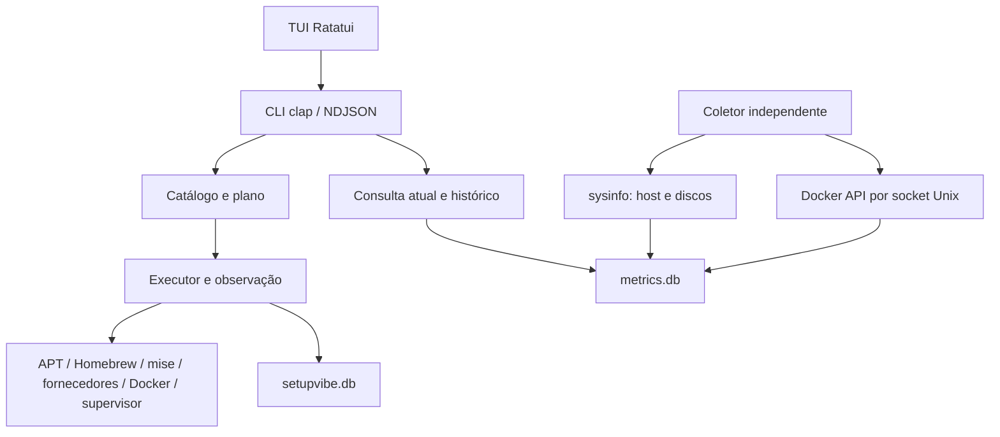

# Arquitetura técnica

O núcleo Rust concentra catálogo, planejamento, execução, adaptadores e estado.
O CLI entrega protocolos de automação. A TUI inicia o mesmo executável em
NDJSON para acompanhar operações sem duplicar regras de instalação. O coletor
usa uma entrada própria e continua independente da interface.



## Bibliotecas e módulos

| Camada | Código | Responsabilidade |
| --- | --- | --- |
| Interface de automação | `src/main.rs`, `output.rs` | Parsing, autorização, JSON/NDJSON e códigos de saída |
| Interface interativa | `src/tui/` | Foco, seleção, revisão, transporte e renderização |
| Domínio e catálogo | `domain.rs`, `catalog.rs` | Edições, plataformas, schema, componentes e opções |
| Plano e execução | `planner.rs`, `executor.rs` | Dependências necessárias, exclusividade, aplicação e verificação |
| Gerenciadores | `adapters.rs`, `vendor.rs`, `engine.rs`, `tailscale.rs` | Origem, comandos e instaladores específicos |
| Serviços | `docker.rs`, `services.rs`, `swarm.rs`, `swarm_services.rs` | Projeção pública, propriedade, persistência e controles |
| Estado | `state.rs` | SQLite, locks, migração, reconciliação e backup |
| Coleta e consulta | `collector.rs`, `metrics.rs` | Ciclos independentes, retenção, atualidade e paginação |
| Supervisão | `supervisor.rs` | Unidades systemd/launchd, recibos e ciclo de vida |
| Subprocessos | `process.rs` | argv separado, stdin, timeout, cancelamento e filtragem |

A versão vem de `Cargo.toml` e o lockfile fixa as dependências. clap faz o
parsing, serde valida estruturas, rusqlite inclui SQLite 3.53.2, sysinfo coleta
o host, Ratatui 0.29 renderiza e Crossterm 0.28 recebe eventos. chrono, uuid,
regex, sha2, ctrlc e libc atendem tempo, identidade, filtragem, hashes e sinais.
O programa não exige um runtime Node ou Python para funcionar.

Node.js é usado somente em scripts e testes de desenvolvimento. O bootstrap é
Bash e instala um executável compilado. Linux usa musl estática na distribuição.
macOS usa Mach-O com deployment target 14.0. Os detalhes de build e os limites
de publicação estão no [guia de distribuição](DISTRIBUTION.md).

## Operação de componente

O CLI valida a edição e o alvo antes de resolver dependências. O executor
observa as instalações para retirar etapas dispensáveis. Instalar um componente
já presente preserva a instalação. Atualizar um componente ausente não instala
dependências para depois falhar. O proprietário observado define o adaptador
usado na atualização.

Antes de mutar, o executor obtém exclusividade do host e do diretório de estado.
Cada etapa recebe um registro e é verificada após a execução. As transações
SQLite são curtas, sem manter um download dentro de uma transação. Falhas
parciais preservam resultados anteriores e impedem etapas dependentes da etapa
que falhou.

```bash
setupvibe component install redis postgresql --dry-run --output json
setupvibe component install redis postgresql --yes --output ndjson
setupvibe component inspect redis --output json
setupvibe updates list redis --output json
setupvibe operation list --limit 10 --output json
```

Sem Docker instalado, a prévia explicita que a descoberta dos serviços será
feita depois da instalação do runtime. A execução revalida nomes, portas,
volumes e propriedade antes de criar o serviço. Não promete que uma prévia
congele o estado do host contra alterações externas.

## Falhas e subprocessos

Comandos recebem executável e argumentos separados. O catálogo não contém
shell arbitrário. Os processos têm grupo próprio, stdin fechado por padrão e
limites de tempo. Entrada secreta usa pipe quando a operação permite, como no
join de Swarm. Capturas finitas limitam memória e removem padrões conhecidos
de credenciais antes da saída pública.

JSON externo é lido em memória e projetado para campos públicos. Docker inspect
não é persistido integralmente, pois pode incluir variáveis sensíveis. Logs
são filtrados, mas nenhum filtro reconhece todo segredo arbitrário. A operação
não deve receber credenciais por argv ou opções de catálogo.

Interrupções normais registram cancelamento. Encerramento forçado ou queda de
energia pode deixar uma operação incompleta, identificada pela reconciliação.
Não há rollback universal para gerenciadores de terceiros. A atualização de
containers gerenciados possui restauração específica do container anterior,
com preservação de volumes.

## Coletor e concorrência

O coletor tem ciclos separados para host e Docker, cada um com conexão própria
no banco de métricas. Timeout do Docker não interrompe a coleta do host. O
endpoint fica fixo durante o ciclo e deltas são reiniciados quando a origem
muda ou existe lacuna temporal. Consultas usam leitores WAL e não precisam
interromper o processo.

O supervisor instala uma cópia privada do executável do coletor. Atualizar o
CLI principal não reinicia esse serviço por consequência. A operação
`collector update` faz a troca explícita e preserva sua configuração.

## Condições de sucesso

CLI e TUI devem produzir o mesmo resultado para uma mesma solicitação e estado
do host. Uma falha por componente precisa aparecer no histórico e no protocolo
de saída. Dados ausentes não podem virar zero e uma interface fechada não pode
encerrar a supervisão independente. Esses contratos são conferidos em
[aceitação](ACCEPTANCE.md) e nos testes Node.

## Referências

- [clap](https://docs.rs/clap/4.6.0/clap/).
- [rusqlite](https://docs.rs/rusqlite/0.40.2/rusqlite/).
- [SQLite WAL](https://sqlite.org/wal.html).
- [sysinfo](https://docs.rs/sysinfo/0.37.2/sysinfo/).
- [Ratatui](https://docs.rs/ratatui/0.29.0/ratatui/).
